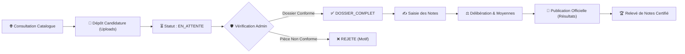

<div align="center">

# 🇸🇳 SunuXam
### Plateforme Nationale de Gestion Intégrale des Concours & Examens d'État

*« Digitalisation, Transparence et Mérite au service de l'Administration Publique Sénégalaise »*

<br/>

[](https://spring.io/projects/spring-boot)
[](https://angular.dev)
[](https://tailwindcss.com)
[](https://www.postgresql.org)
[](https://jwt.io)
[](https://openjdk.org)

<br/>

> **SunuXam** (*« Notre Savoir »* en Wolof) est une plateforme web moderne et sécurisée conçue pour dématérialiser de bout en bout le cycle de vie des concours nationaux (Fonction Publique, Universités, Grandes Écoles).

🎓 **Projet de Soutenance** — Licence 3 en Génie Logiciel • Promotion 2026

</div>

---

## 📑 Sommaire

* [🛠 Architecture & Stack Technologique](#-architecture--stack-technologique)
* [🔄 Workflow des Candidatures (Architecture Métier)](#-workflow-des-candidatures)
* [⚖️ Règles de Gestion Implémentées](#️-règles-de-gestion-implémentées)
* [🚀 Installation & Démarrage Rapide](#-installation--démarrage-rapide)
* [📖 Documentation API REST (Swagger)](#-documentation-api-rest-swagger)
* [📁 Structure Complète du Projet](#-structure-complète-du-projet)
* [🎯 Fonctionnalités Clés Démontrées](#-fonctionnalités-clés-démontrées)

---

## 🛠 Architecture & Stack Technologique

<table>
<tr>
<td width="50%" valign="top">

### 🖥️ Backend (Architecture REST & Sécurisée)

* **Socle** : Java 21 LTS & Spring Boot 3.3.5
* **Sécurité** :
  * Spring Security 6 (Stateless JWT JJWT 0.12.6)
  * Chiffrement fort des mots de passe avec **BCrypt**
  * Contrôle d'accès par rôles stricts (`ROLE_CANDIDAT`, `ROLE_ADMIN`)
* **Persistance & Données** :
  * Spring Data JPA & Hibernate
  * Base principale **PostgreSQL** (avec support mémoire H2 de secours)
  * Initialisation automatique des données via `DatabaseSeeder`
* **Validation & Erreurs** :
  * Bean Validation (Jakarta Validation)
  * Format d'erreur standardisé RFC Problem Details
* **Fichiers & Uploads** :
  * Stockage local structuré des justificatifs (CV, Diplômes, Photos)
  * Contrôle strict des types MIME et tailles
* **Documentation** : SpringDoc OpenAPI 3 & Swagger UI

</td>
<td width="50%" valign="top">

### 🎨 Frontend (Single Page Application)

* **Socle** : Angular 18+ (Architecture Standalone, Signals & RxJS)
* **Design & Styles** :
  * Tailwind CSS avec mode sombre forcé (`class="dark"`)
  * Design System personnalisé **Dark Glassmorphism**
  * Classes utilitaires riches (`.btn`, `.card`, `.form-input`, `.alert`)
  * Support d'impression CSS dédié (`@media print`) pour l'export des relevés
* **Communication HTTP** :
  * `HttpClient` Angular avec intercepteur JWT automatique
  * Gestion centralisée des erreurs API
* **Navigation & Sécurité** :
  * Angular Router avec Lazy Loading
  * Guards d'authentification (`authGuard`, `adminGuard`)
* **Typographies** : Google Fonts *Outfit* & *Inter*

</td>
</tr>
</table>

---

## 🔄 Workflow des Candidatures



---

## ⚖️ Règles de Gestion Implémentées

| Code RG | Domaine | Description Métier |
| :--- | :--- | :--- |
| **RG-AUTH-01/02** | Authentification | Unicité stricte de l'email et du téléphone, hachage BCrypt et cloisonnement des rôles (`ROLE_CANDIDAT`, `ROLE_ADMIN`). |
| **RG-CONC-01/03** | Concours | Date limite d'inscription $\ge$ Date début, coefficients des épreuves $> 0$, composition dynamique de 1 à N épreuves. |
| **RG-CAND-01/02** | Candidature | **Candidature unique** par concours et par candidat, dépôt obligatoire des pièces justificatives (CV, Diplôme, Photo d'identité). |
| **RG-CAND-04** | Cycle de vie | Transition contrôlée : `EN_ATTENTE` $\rightarrow$ `DOSSIER_COMPLET` (ou `REJETE`) $\rightarrow$ `EN_DELIBERATION` $\rightarrow$ `DELIBERE`. |
| **RG-NOTE-02/03** | Notation | Barème standard 0.0 à 20.0, **calcul automatique de la moyenne pondérée** : $\frac{\sum (\text{Note}_i \times \text{Coef}_i)}{\sum \text{Coef}_i}$. |
| **RG-NOTE-04/05** | Classement | Classement automatique par rang décroissant et attribution des mentions (`ADMIS`, `LISTE_D_ATTENTE`, `NON_ADMIS`). |
| **RG-PUB-01/02** | Publication | **Confidentialité absolue pré-délibération** et action irréversible de publication officielle visible instantanément par les candidats. |

---

## 🚀 Installation & Démarrage Rapide

### Prérequis Système
* **Java 17+ ou 21** (`java -version`)
* **Node.js 18+** & **NPM** (`node -v`, `npm -v`)
* **PostgreSQL** *(optionnel, fallback automatique sur mémoire H2 si PostgreSQL est indisponible)*

---

### 1️⃣ Démarrage du Backend (Spring Boot)

```bash
# Se placer dans le répertoire backend
cd backend

# Sous Windows :
.\mvnw.cmd spring-boot:run

# Sous Linux / macOS :
./mvnw spring-boot:run
```

> [!NOTE]
> Le serveur API démarre sur : **`http://localhost:8080`**

---

### 2️⃣ Démarrage du Frontend (Angular)

```bash
# Dans un second terminal, se placer dans le répertoire frontend
cd frontend

# Lancement du serveur de développement Angular
npm start
```

> [!NOTE]
> L'application Web est accessible sur : **`http://localhost:4200`**

---

## 📖 Documentation API REST (Swagger)

Une fois le backend démarré, la console interactive OpenAPI / Swagger UI est disponible sur :

🔗 **`http://localhost:8080/swagger-ui.html`**

Principaux contrôleurs documentés :
* 🔐 **`Auth Controller`** (`/api/auth/**`) : Inscription, Authentification & Génération JWT
* 🏆 **`Concours Controller`** (`/api/concours/**`) : Catalogue, Consultation publique et Détails
* 📝 **`Candidature Controller`** (`/api/candidatures/**`) : Dépôt multipart, Historique et Suivi
* 📂 **`File Controller`** (`/api/files/**`) : Téléchargement et visualisation des pièces jointes
* 📊 **`Resultat Controller`** (`/api/resultats/**`) : Consultation publique des listes officielles
* ⚙️ **`Admin Controller`** (`/api/admin/**`) : Dashboard, Gestion des épreuves, Saisie et PV de délibération

---

## 📁 Structure Complète du Projet

```text
sunuxam/
├── backend/                              # Application Spring Boot 3 (API REST)
│   ├── src/main/java/com/opticoncours/
│   │   ├── config/                       # SecurityConfig, JwtFilter, OpenAPI, WebConfig, DatabaseSeeder
│   │   ├── controller/                   # Endpoints REST (Auth, Concours, Candidature, Admin, etc.)
│   │   ├── dto/                          # Objets de transfert de données (Request / Response)
│   │   ├── entity/                       # Entités JPA (User, Concours, Epreuve, Candidature, Note, Resultat)
│   │   ├── exception/                    # Gestionnaire global d'exceptions (RFC Problem Details)
│   │   ├── repository/                   # Repositories Spring Data JPA
│   │   └── service/                      # Logique métier, Algorithmes de moyenne, Uploads
│   ├── src/main/resources/
│   │   └── application.yml               # Paramètres JWT, Base de données, Uploads
│   ├── uploads/                          # Répertoire local des documents justificatifs stockés
│   └── pom.xml                           # Configuration Maven & Dépendances
│
└── frontend/                             # Application SPA Angular 18+
    ├── src/app/
    │   ├── core/                         # Guards de routage, Intercepteur HTTP JWT, Services API
    │   ├── models/                       # Modèles et interfaces TypeScript
    │   ├── shared/                       # Navbar givrée, Footer, StatusBadge néon
    │   └── features/
    │       ├── public/                   # Accueil (Glassmorphism), Détail Concours, Résultats Officiels
    │       ├── auth/                     # Connexion & Inscription Candidat
    │       ├── candidate/                # Espace Candidat, Postuler (Uploads), Suivi et Relevé de notes
    │       └── admin/                    # Backoffice : Dashboard, Concours, Candidatures, Saisie Notes, Délibération
    ├── src/styles.css                    # Design System Dark Glassmorphism, animations & Print CSS
    ├── tailwind.config.js                # Configuration du thème, palette Dracula/Velvet & utilitaires
    └── package.json                      # Scripts et dépendances NPM
```

---

## 🎯 Fonctionnalités Clés Démontrées

### 1. Espace Public & Candidat
* 🔍 **Recherche temps réel** avec filtrage instantané par mots-clés.
* 📋 **Fiches concours détaillées** précisant conditions d'accès, dates limites et barème des épreuves.
* 📤 **Dépôt 100% numérique** avec upload simultané des pièces requises (CV, Diplôme, Photo).
* 🧭 **Fil d'ariane & Timeline interactive** pour suivre chaque étape d'instruction du dossier.
* 📜 **Relevé de notes officiel certifié** avec calcul détaillé des coefficients, sceau officiel et bouton d'impression PDF instantané.

### 2. Backoffice Administration & Jurys
* 📊 **Tableau de bord d'analyse** avec indicateurs clés (concours ouverts, places, candidatures reçues).
* 🗂️ **Gestion dynamique des concours** et configuration sur-mesure des épreuves et coefficients.
* 🔍 **Contrôle documentaire** : visualisation directe des pièces jointes, validation ou rejet avec notification du motif.
* ✍️ **Saisie fluide des notes** avec calcul automatique et immédiat des moyennes pondérées.
* ⚖️ **Moteur de délibération automatisé** : simulation instantanée des admis selon le nombre de places et génération du classement au mérite.
* 📢 **Publication officielle sécurisée** rendant les résultats instantanément consultables de manière infalsifiable.

---

<div align="center">

**🇸🇳 République du Sénégal • Ministère de la Fonction Publique**  
*Projet réalisé pour la validation du diplôme de Licence 3 Génie Logiciel — Session 2026*

</div>
