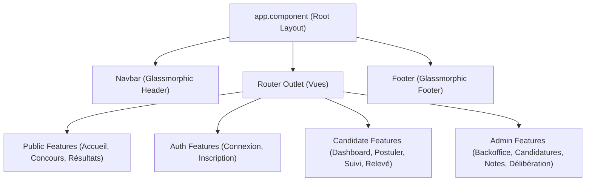

<div align="center">

# 🎨 SunuXam - Frontend Web Client (Angular 18+)

### Interface Utilisateur Moderne • Design System Dark Glassmorphism

[](https://angular.dev)
[](https://tailwindcss.com)
[](https://www.typescriptlang.org/)
[](https://vitejs.dev/)

<br/>

> Application monopage (SPA) haute performance dédiée à la consultation des concours, au dépôt numérique des candidatures, au suivi en temps réel et à l'administration des examens d'État du Sénégal.

</div>

---

## 📑 Sommaire

* [✨ Identité Visuelle & Design System](#-identité-visuelle--design-system)
* [🏗 Architecture Technique](#-architecture-technique)
* [📁 Structure des Modules et Composants](#-structure-des-modules-et-composants)
* [🔐 Gestion de l'Authentification & Sécurité](#-gestion-de-lauthentification--sécurité)
* [🚀 Démarrage & Scripts Disponibles](#-démarrage--scripts-disponibles)
* [🖨️ Fonctionnalité d'Impression Certifiée](#️-fonctionnalité-dimpression-certifiée)

---

## ✨ Identité Visuelle & Design System

L'application arbore une charte graphique **Dark Glassmorphism** reposant sur la palette **Dracula / Velvet** :

* 🌌 **Arrière-Plan Sombre & Profond** : Teinte veloutée `#1e1e2e` avec dégradés radiaux lumineux (*Lilas* et *Bleu Ciel*).
* 🔮 **Accents Colorés** :
  * **Primaire (Lilas)** : `#cba6f7` (survol : `#b4befe`)
  * **Accent (Bleu Ciel pastel)** : `#89b4fa` (survol : `#74c7ec`)
  * **Secondaire (Rose doux)** : `#f5c2e7`
* 🪟 **Verre Dépoli Givré (`backdrop-blur-xl`)** : Conteneurs translucides `bg-white/[0.04]` avec liserés lumineux `border-white/10` et reflets biseautés.
* 🖋️ **Typographies Modernes** : Intégration de Google Fonts **Outfit** (titres expressifs) et **Inter** (lisibilité des données).
* ⚡ **Micro-Animations Réactives** : Élévation dynamique des cartes (`hover:-translate-y-1`), halos néon et retour haptique visuel (`active:scale-95`).

---

## 🏗 Architecture Technique



### Concepts Clés Angular Utilisés :
* **Composants Standalone** : Élimination des `NgModule` pour une modularité maximale et un chargement accéléré.
* **Angular Signals & RxJS** : Réactivité granulaire, détection des changements optimisée et gestion asynchrone fluide des requêtes HTTP.
* **Intercepteur JWT Automatique** : Injection automatique du token Bearer dans les requêtes vers l'API Spring Boot.
* **Guards Déclaratifs** :
  * `authGuard` : Protection de l'espace candidat.
  * `adminGuard` : Protection stricte du backoffice avec vérification du rôle `ROLE_ADMIN`.

---

## 📁 Structure des Modules et Composants

```text
frontend/src/
├── app/
│   ├── core/                         # Cœur de l'application (Singleton)
│   │   ├── guards/                   # auth.guard.ts (Candidat & Admin)
│   │   ├── interceptors/             # auth.interceptor.ts (JWT Bearer)
│   │   └── services/                 # auth.service.ts, concours.service.ts, etc.
│   │
│   ├── models/                       # Typage TypeScript strict
│   │   └── models.ts                 # User, Concours, Epreuve, Candidature, Resultat
│   │
│   ├── shared/                       # Composants UI partagés réutilisables
│   │   └── components/
│   │       ├── navbar/               # Barre de navigation en verre dépoli
│   │       ├── footer/               # Pied de page institutionnel
│   │       └── status-badge/         # Badges de statut néon translucides
│   │
│   └── features/                     # Vues métiers (Lazy Loaded)
│       ├── public/                   # Accueil, Détails Concours, Résultats Officiels
│       ├── auth/                     # Connexion & Inscription
│       ├── candidate/                # Dashboard, Dépôt, Suivi & Relevé
│       └── admin/                    # Layout Admin, Dashboard, Saisie Notes, Délibération
│
├── styles.css                        # Design System Dark Glassmorphism & Print CSS
├── index.html                        # Point d'entrée avec balise html class="dark" & polices
└── tailwind.config.js                # Configuration Tailwind (tokens, couleurs, ombres)
```

---

## 🚀 Démarrage & Scripts Disponibles

### Prérequis
* **Node.js** version 18 ou supérieure (`node -v`)
* **NPM** version 9 ou supérieure (`npm -v`)

### Installation des dépendances
```bash
npm install
```

### Lancement du serveur de développement
```bash
npm start
# ou
ng serve
```
> Accédez à l'application sur **`http://localhost:4200`**. Le rechargement à chaud (HMR) est activé.

### Compilation pour la Production
```bash
npm run build
# ou
ng build --configuration production
```
> Les fichiers optimisés et minifiés seront générés dans le dossier `dist/`.

---

## 🖨️ Fonctionnalité d'Impression Certifiée

Le relevé de notes officiel bénéficie de règles CSS `@media print` sur-mesure dans `src/styles.css` :
* Masquage automatique de la navbar, du footer et des boutons d'actions interactifs (`.no-print`).
* Préservation des logos républicains, des notes pondérées, du rang de classement et du sceau officiel pour un export papier ou PDF net et certifié.

---

<div align="center">
  <sub>SunuXam • Projet de Licence 3 Génie Logiciel 2026</sub>
</div>
